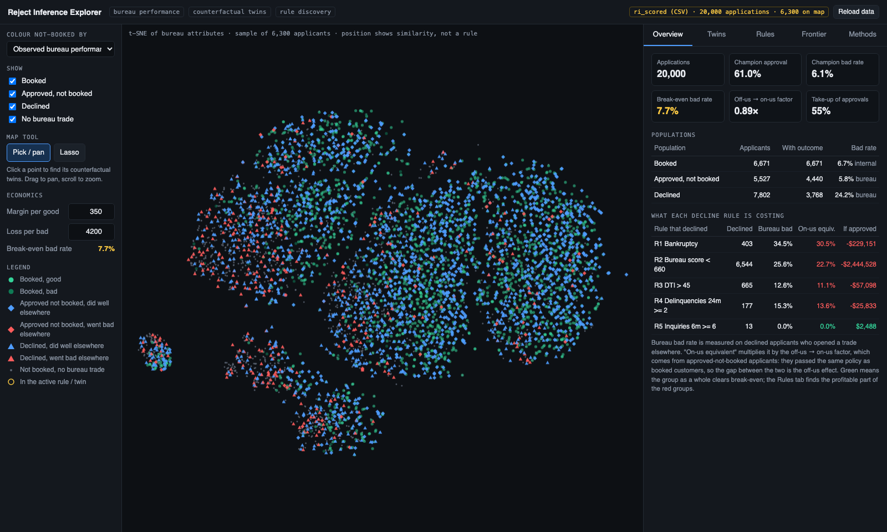

# Modern Reject Inference

Reject inference with credit bureau data: find the good applicants a credit policy declined, and turn that finding into a rule you can test.

A lender only observes repayment on the accounts it booked. This project uses bureau performance on trades that not-booked applicants opened elsewhere to do three things:

1. **Grade** the classical reject-inference methods (hard cutoff, parceling, fuzzy augmentation) against what actually happened.
2. **Explore** the through-the-door population on a similarity map, and look up the *counterfactual twins* of any applicant.
3. **Search** for swap-in rules that clear break-even, with a holdout, and export them as a strategy tree.

Everything runs locally on CSV files with Python, pandas, scikit-learn and Flask. All data in this repository is synthetic.

**Live demo:** https://luizkauffmann.github.io/Modern-Reject-Inference/ runs the same app in your browser, with no server and nothing to install. The site also has the [slides](https://luizkauffmann.github.io/Modern-Reject-Inference/demo/slides.html) that explain the method step by step.



## Quick start

```bash
pip install -r requirements.txt
python data/generate_data.py            # four synthetic source tables, 20,000 applications
python -m reject_inference.pipeline     # models, inferred outcomes, similarity map (about a minute)
python app.py                           # open http://127.0.0.1:5000
```

Python 3.9 or later.

## What is in the box

| Path | Content |
|---|---|
| `data/generate_data.py` | Synthetic data generator, standard library only. |
| `reject_inference/pipeline.py` | The modelling pipeline: booked-only model, three inference methods, final models, map. |
| `reject_inference/explorer.py` | The analytics (twins, rule scoring, threshold sweep, bump hunting, lasso to rule, frontier) and the web API. |
| `reject_inference/ui/` | The single-page front end (plain HTML, CSS and JavaScript, no build step). |
| `app.py` | Flask entry point. |
| `strategies/trees/` | Strategy trees. `CHAMPION_POLICY.json` is the current policy; exported challengers land here. |
| `docs/methodology.md` | The method, formula by formula. |
| `docs/demo/` | The website served by GitHub Pages: landing page, the Explorer running in the browser (Pyodide), and the slides. |
| `tools/build_site.sh` | Refreshes `docs/demo/app` and `docs/demo/data` from the sources. Run it after changing the code or rebuilding the data. |

## The method in one page

**Populations.** Booked (`BK`, internal outcome known), approved-not-booked (`ANB`) and declined (`DEC`). For not-booked applicants who opened a similar trade elsewhere, the bureau outcome `bad_bur` is known. It is never used for training.

**Inference.** A logistic regression on booked accounts gives `p_kgb`. Not-booked applicants then receive an outcome three ways:

| Method | Rule |
|---|---|
| Hard cutoff | bad if `p_kgb >= 0.20` |
| Parceling | bad with probability `min(1, 1.5 x booked bad rate of the score band)` |
| Fuzzy augmentation | two weighted rows: bad with weight `p_kgb`, good with weight `1 - p_kgb` |

**From off-us to on-us.** Within each score band, the internal bad rate of booked accounts is compared with the bureau bad rate of approved-not-booked applicants. The volume-weighted ratio (limited to 0.5 to 1.5) converts a bureau bad rate into an on-us equivalent.

**Economics.** `break-even = margin / (margin + loss)` and `profit = n x take-up x ((1 - b) x margin - b x loss)`, where `b` is the on-us equivalent bad rate of a group.

**Map.** 22 attributes are median-filled, clipped at the 1st and 99th percentile, standardised, and projected with t-SNE on a stratified sample. The map is a display only: no rule or statistic is computed from its coordinates.

**Twins.** The 10 nearest neighbours by Euclidean distance on the 22 standardised attributes, taken from the opposite population (booked against not-booked with a bureau outcome).

**Rule search.**

- *Threshold sweep*: relax one policy cut at a time, counting only applicants declined by that rule alone.
- *Bump hunting* (PRIM): peel 8% from one edge of one attribute at a time, keeping the peel that leaves the highest share of good performers; simplify and round the box into a readable rule.
- *Lasso to rule*: draw a region on the map; a depth-3 decision tree describes it on the original attributes.

Every candidate is scored the same way, including on a random 30% holdout the search never saw.

## Using your own data

The Explorer needs one table, `data/ri_scored.csv`, one row per application:

| Group | Columns |
|---|---|
| Required | `app_id`, `seg` (`BK`, `ANB`, `DEC`), `decision` (`APPROVE`, `DECLINE`), `decline_rule` (starting with the rule id, for example `R2_...`), `bk_flag`, `bad_int`, `bad_bur`, `has_bur`, and the 22 attributes listed in `FEATURES` |
| Optional | `p_kgb`, `band`, `p_hc`, `p_pcl`, `p_fz`, `bad_hc`, `bad_pcl`, `bad_fz`, `score_12m` |

To start from your own source tables instead, shape them like the four files written by `data/generate_data.py` and run the pipeline. To use different attributes or a different policy, edit `FEATURES`, `LABELS`, `POLICY` and `SWEEPS` at the top of `reject_inference/explorer.py`.

Settings: `RI_DATA_DIR`, `RI_STRATEGY_DIR`, `RI_HOST`, `RI_PORT` (environment variables); `--hc-cut` and `--pcl-mult` on the pipeline.

## Limits

- **Selection in bureau outcomes.** A bureau outcome exists only for applicants another lender approved. They are probably better than declined applicants who obtained nothing. The off-us factor does not correct for this.
- **The factor is estimated on approved applicants** and applied to declined ones. That it holds lower in the score range is an assumption.
- **Rule search can overfit.** The holdout helps, but the same data chooses among candidates. On the synthetic sample the most profitable bump-hunting rule shows 2.5% on-us equivalent in the search but 7.6% on the holdout, barely under the 7.7% break-even and measured on 58 outcomes. Validate on a later period, then run a controlled champion/challenger test.
- **Parceling is random**, so its labels change with the seed.
- **Scale.** The app loads the whole table in memory. It suits tens or hundreds of thousands of rows.
- **Not a production decision system.** Any rule that changes who is approved needs the usual model-risk and fair-lending review.

## Tests

```bash
python -m unittest discover -s tests
```

## Licence

Apache License 2.0. See `LICENSE`.
